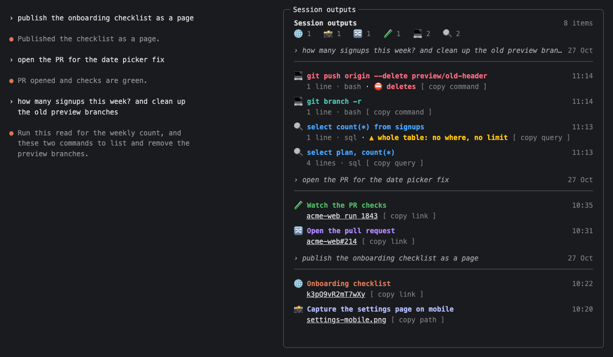

# session-outputs

[](https://mods.aidojo.si/mods/gorkamb--claude-session-outputs--session-outputs/)
[](https://mods.aidojo.si/mods/gorkamb--claude-session-outputs--session-outputs/)

A side pane for Claude Code that collects what the session made for you:
screenshots, files, published pages, docs, pull requests, CI runs, and the commands
Claude asks you to run. No more scrolling back to find them.



## Get started

**1. Install.** In Claude Code, run:

```
/plugin install session-outputs --marketplace gorkamb/claude-session-outputs
```

Answer `y` to add the marketplace, and pick "user" to have it in every project.
Then load it into the running session:

```
/reload-plugins
```

A session started after the install loads it by itself.

**2. Set it up for your project.** In the project, run:

```
/session-outputs:setup
```

Claude looks at the project and tells the pane which commands touch
production or destroy data, so it can warn you about them. It writes
`.claude/session-outputs.json`, which you can commit. Names only, never
secrets. Optional, but worth the minute.

**3. Use it.** The pane opens by itself when there is something to show.
Type `/outputs` to open it any time.

<details>
<summary>Other ways to install</summary>

From a shell:

```
claude plugin marketplace add gorkamb/claude-session-outputs
claude plugin install session-outputs@session-outputs
```

</details>

## What it shows

| Entry | When | Button |
| --- | --- | --- |
| 📸 📕 🎬 📊 📄 Files | Claude writes an image or SVG, a PDF, a video, an HTML page, a CSV or spreadsheet, a Word document, a deck or a zip | copy path |
| 🌐 Pages | Claude publishes an Artifact: a page, a design, a deck | copy link |
| 📝 Docs | Claude creates a document with the Claude Docs connector | copy link |
| 🔀 Pull requests | `gh pr create` opens one | copy link |
| 🧪 CI runs | `gh pr checks` or `gh run` shows one | copy link |
| 💻 Commands | an answer has a shell block | copy command |
| 🔍 Queries | an answer has a SQL block | copy query |

Newest first, grouped under the message that made them. Only things you can
open are listed: a file Claude only mentioned never shows up, and a deleted
file disappears.

## Warnings

Commands and queries get a warning when they look dangerous:

| Mark | Meaning |
| --- | --- |
| `⛔` (red) | deletes, drops, wipes or force-pushes |
| `▲` | writes in a way that is easy to miss (`curl -X POST`, `sed -i`, a `>` redirect, `update … where`), runs code it is handed (`curl … \| bash`), or a slow query |
| `· prod` | aimed at production |

Quoted text is read too, so a command handed to `ssh`, `bash -c` or `psql -c`
gets the same warning as one typed directly.

**No mark does not mean safe.** It means nothing dangerous was spotted. The
pane never calls a command safe: proving from the text alone that a command
only reads cannot be done reliably, while spotting the dangerous ones can.
Obvious writes like `git push` or `npm install` get no mark either, since you
can see them.
It reads the text and runs nothing, so still read what you paste.

## The config file

`/session-outputs:setup` writes this for you. To write it by hand:

```json
{
  "prod": ["flyctl", "/acme-(live|main)/"],
  "destroy": ["make reset-db"]
}
```

- `prod`: words that mean production; adds `· prod`
- `destroy`: commands that destroy data; shown in red

Each entry is plain text (any case) or a `/regular expression/`. After editing
the file yourself, type `/outputs` to reload it.

A project's file and your personal one, `~/.claude/session-outputs.json`, are
merged. Both can only add warnings.

## What it reads and sends

It reads the session's tool calls and Claude's answers, checks that a listed
file exists, reads the `<title>` of a page it lists, and reads the two config
files. It runs no commands, sends nothing over the network, and keeps its
list inside Claude Code's own session state.

## Good to know

- Needs a Claude Code version whose plugins can open a side pane; tested with
  Claude Code 2.1.310 and 2.1.311.
- Runs in Claude Code in the terminal. The desktop app lists it as disabled,
  with no way to turn it on.
- Pull requests and runs are recognised on github.com only.
- On mobile you can copy a file's path but not open the file.
- Tested by hand in the macOS terminal. The tests also cover Windows paths and
  how the pane draws in other Claude Code surfaces, which have not been tried
  by hand.

## Developing

```
git clone https://github.com/gorkamb/claude-session-outputs
claude plugin marketplace add ./claude-session-outputs
claude plugin install session-outputs@session-outputs
```

Edit, then `/reload-plugins`. Tests: `claude plugin test .`. Editor types
appear in `.claude-plugin/types/` once Claude Code has loaded the plugin.

The screenshot is `docs/pane-mock.html` (made-up data) rendered with Chrome:

```
chrome --headless --screenshot=docs/screenshot.png --window-size=1320,770 docs/pane-mock.html
```

The icon is `docs/icon.html`, the same way:

```
chrome --headless --default-background-color=00000000 --screenshot=.claude-plugin/icon.png --window-size=1024,1024 docs/icon.html
```

## License

MIT
